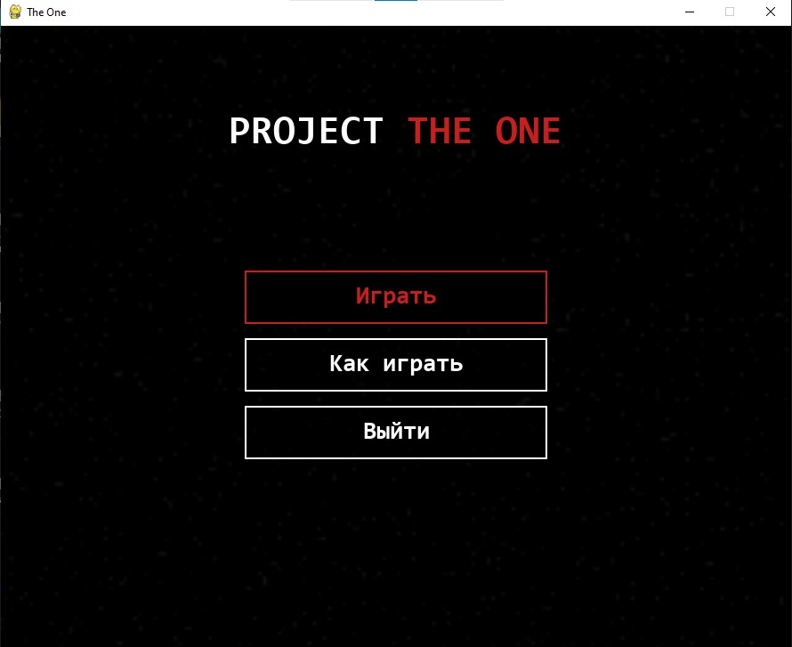
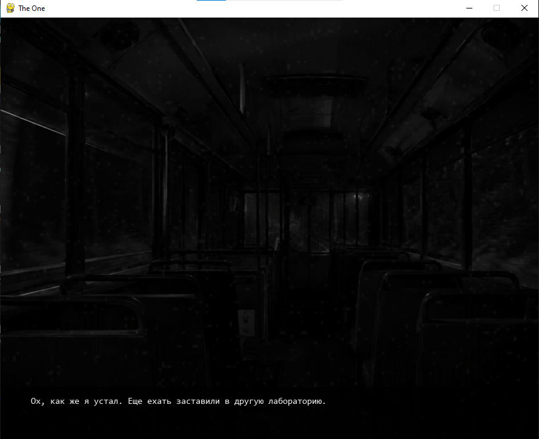
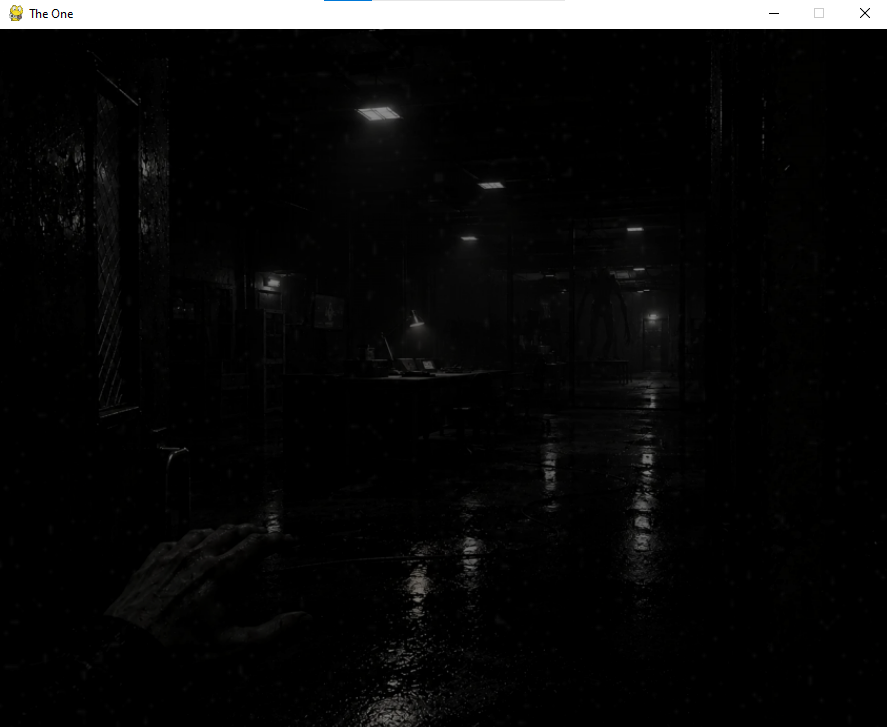
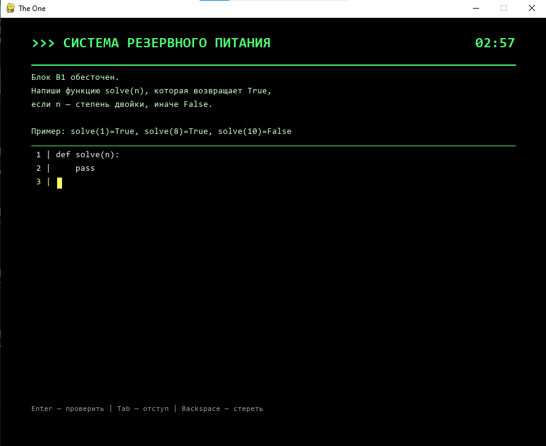
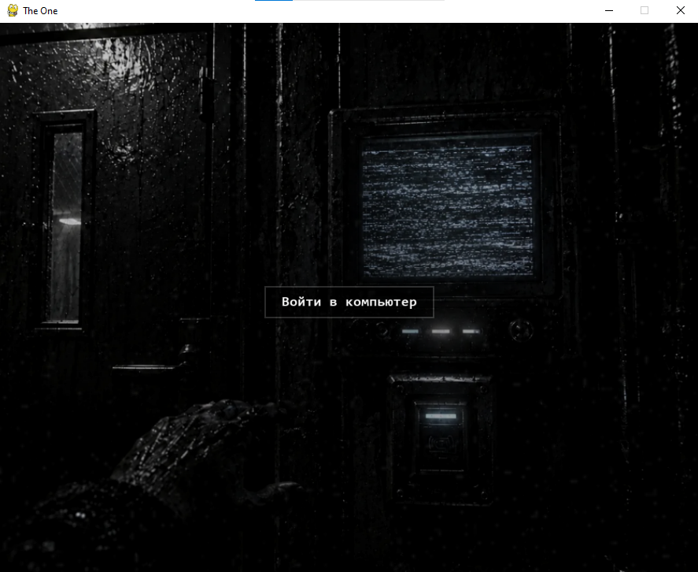

# The One

* **ID:** NS-020
  
* **Status:** Product

> **Survive the dark. Code your way out.** A psychological horror visual novel where your only weapon is Python.

## 📖 About
* Late in the evening, you – a lab technician and programmer – have just finished your main shift when you're urgently called to another NESTIMS laboratory.

* The reason is unknown: just a short message with an access code and an address. You don't even have time to change.

* What seemed like a minor inconvenience quickly turned into a fight for survival.

* You missed your stop and decided to take a shortcut through the territory of an abandoned NESTIMS laboratory. What seemed like a minor inconvenience quickly turned into a fight for survival.
  
* The doors locked behind you. The power is out. And something is hunting you in the dark.

* **Project The One** is a first-person horror narrative built entirely on static scenes. There are no 3D graphics or complex movement mechanics. Your progression relies on exploring the environment and interacting with it.
  
* The game features a unique survival mechanic: to hack security systems, open doors, or call for help, you must write actual Python code under extreme pressure. A hidden timer is always ticking, and the monster's growls are getting closer.
  
* One mistake in your code, or a missed deadline, and the hunt ends.

## 🎯 Project Goal

* Create an atmospheric horror experience driven by static visuals and sound design.
  
* Integrate real programming tasks into the core gameplay loop.
  
* Challenge the player's ability to write logical code under time pressure and psychological stress.
  
* Deliver a complete, standalone narrative with a cliffhanger ending.

## 🎮 Gameplay & Features

### 1. Scene-by-Scene Progression
* The game consists of a series of static, hand-drawn scenes (TO1 – TO34).
  
* Transitions between scenes occur in two ways: either automatically (seamless cuts) or by clicking a prompt that appears after a few seconds.
  
* Special effects like camera shake, Ken Burns zoom, CRT film grain, and vignette keep the static images alive.

### 2. Python Terminal Puzzles
* At key moments, you will need to access computer terminals.
  
* The game features a custom built-in IDE with a retro CRT boot screen.
  
* You will be given a programming task (e.g., checking if a number is a power of two, or identifying a palindrome).
  
* **Strict Time Limit:** You have exactly 3 minutes to write a working `solve()` function.
  
* Your code is tested in real-time against hidden test cases. If the timer runs out or the tests fail, the monster finds you.

### 3. Immersive Audio & Visuals
* Dynamic sound design: from the distant rumble of the bus to the industrial alarm, the metallic creaking of gates, and the terrifying breath of the monster.
  
* Custom visual effects: closing eyelids, screen glitches, and fade transitions.
  
* No voice acting is required; the story is told through atmospheric text and sound.

### 4. Defeat & Survival
* If you fail a terminal task, you don't just retry. The monster attacks, resulting in a brutal game over screen.
  
* You must survive the laboratory, navigate the corridors, and reach the watchtower to signal for rescue.

## 🛠 Technology Stack

| Technology | Purpose |
| :--- | :--- |
| Python | Core application logic |
| Pygame | Game engine, rendering, and sound mixing |
| `ast` | Safe parsing and validation of user-written code |
| PyInstaller | Compiling the game into a standalone `.exe` file |
| Custom CRT Shaders | Boot screen animation and glitch effects |

## 🚀 Project Run

1. Go to the **Releases** section of this repository.
   
2. Download the latest version of **`TheOne.exe`**.
   
3. Run the executable. All images and sounds are packed inside. Python does not need to be installed.

*(Note: Some antivirus software may falsely flag PyInstaller executables. The file is completely safe).*

## 📸 Screenshots

© NESTIMS
